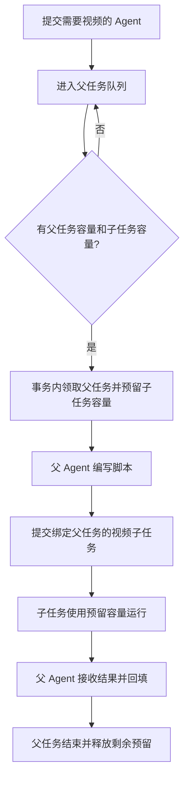

# 方案一：父 Agent 与视频子任务预留容量

日期：2026-11-07  
状态：设计草案，供选型；尚未实施调度改造。  
对应方案：[方案二：独立 Agent 编排服务](Agent并发方案二_独立编排服务.md)

## 1. 目标与结论

在保留现有 Agent 节点同步执行、前端日志和最终输出方式的前提下，避免父 Agent 占满 ComfyUI 实例后，视频子任务因没有空闲实例而中途失败。

推荐做法：需要视频子流程的 Agent 启动前，一次性申请一个父任务运行名额和一个子任务预留名额。容量不足时，父任务留在队列，不开始执行脚本生成。

以当前 4 个同类执行实例为例，最多同时运行两组“父 Agent ＋视频子任务”。这里的两个名额必须由调度器真实保留，不能只修改页面上的并发数字。

## 2. 已确认的现状

- Agent 已通过独立 Python 子进程执行，但 ComfyUI 节点仍等待它返回结果，因此父任务仍占用 ComfyUI 执行实例。
- 视频作为另一条 ComfyUI prompt 提交，需要另外一个匹配资源类型的实例执行。
- Account Manager 的任务授权检查要求父 prompt 仍在运行，并检查账户并发及空闲 worker；不足时返回 HTTP 409。
- 调度器当前的空闲检查和后续任务领取不是父子任务容量预留，存在竞争窗口。
- 当前 CPU 服务器有 4 个 `api` 类实例。本方案只讨论这组执行容量，不代表外部视频供应商也允许同样的并发。

主要代码位置：

| 仓库 | 文件 | 当前职责 |
|---|---|---|
| ComfyUI-Account-Manager | `utils/scheduler_store.py` | 队列、worker 状态、事务领取、账户并发 |
| ComfyUI-Account-Manager | `utils/task_sessions.py` | 父任务身份委托、视频子任务提交授权 |
| ComfyUI-LLM | `agent_worker_client.py` | 启动 Agent 子进程并等待完成 |
| ComfyUI-LLM | `nodes.py`、`web/agent_node.js` | 节点执行、进度事件和界面 |

## 3. 调度流程

建议从“保留同资源池中的一个容量单位”实现，不必固定预留某个端口。这样某个实例离线后，可以由其他健康同类实例执行子任务。所有普通任务领取路径都必须扣除尚未使用的预留，才能保证容量确实可用。

同一资源池的容量约束为：

`已占用运行容量 + 尚未使用的预留容量 ≤ 健康可用总容量`

子任务开始运行时，将一个未使用预留转换为一个运行占用，不额外增加第三个占用。

## 4. 4 个实例的具体行为

| 场景 | 调度结果 |
|---|---|
| 没有任务，连续提交 4 个视频 Agent | 启动 A、B，各占 1 个实例并各预留 1 个；C、D 等待 |
| A、B 都在编写脚本 | 2 个实例执行父任务，2 个容量单位预留，暂时不能给普通任务使用 |
| A、B 都提交视频 | 2 个父任务和 2 个视频任务同时占用 4 个实例 |
| 已有 3 个普通任务运行 | 新视频 Agent 等到至少有 2 个容量单位可用后启动 |
| 已有 1 个普通任务运行 | 可以启动 1 组视频 Agent，剩余 1 个容量可供其他普通任务使用 |
| 不生成子流程的普通 Agent | 按 1 个名额调度 |

这解决的是容量导致的中途失败；网络错误、供应商错误、素材缺失仍需各自处理。

## 5. 如何判断哪些 Agent 需要预留

必须在调度前由受控的工作流或技能配置声明需要视频子任务，不能依赖 Agent 已经执行后再推断，也不能只靠提示词关键词判断。

第一版建议范围：一个父 Agent 同时最多运行一个视频子任务，允许多个视频子任务串行执行。

- 声明会生成视频：启动前申请父任务加一个子任务容量。
- 声明不生成视频：只占一个；若执行时临时要求视频，明确提示任务模式不支持，不能在所有父任务已占满时悄悄升级。
- 多个视频并行、子任务继续派生子任务：第一版不支持，必须另行声明和计算整个依赖链的容量，不能套用“固定两个名额”。

LLM 仓库负责声明能力及携带父子关系；Account Manager 服务端负责验证，不能信任前端随意提交的容量数值。

## 6. 事务、身份与账户并发

在调度器现有 SQLite 事务领取逻辑中完成以下操作：

1. 检查健康实例、资源类型、已有运行占用和预留。
2. 检查账户剩余容量。
3. 领取父任务并创建唯一的预留记录。
4. 一并提交事务；失败则全部不生效。

建议预留记录至少保存父任务 ID、owner、资源类型、容量、状态、当前子任务 ID 和更新时间。父子绑定由服务端根据任务凭据确认。

账户并发需要与物理容量一致。若沿用“同时运行的任务数”这一口径，则父任务启动时要为父子双方预扣账户容量，子任务启动后转换占用，不能再次加算。账户上限只有 1 时，应在入队或准入阶段解释配置不足，不能启动父任务后再拒绝视频。

“一个 Agent 业务任务只算一次用户配额”也可以作为另一种产品规则，但需要单独管理业务任务数与实际执行容量；不能借此绕过物理实例或供应商限制。第一版建议沿用现有账户口径，减少语义变更。

当前 `task_sessions.py` 中的“必须立即有空闲实例”判断需要改为识别有效预留。有效子任务可入队等待短暂的领取交接，不应因瞬间没有 idle worker 返回容量类 409。

## 7. 预留生命周期与异常

| 事件 | 处理要求 |
|---|---|
| 父任务排队时取消 | 移除排队项；没有预留可释放 |
| 父任务运行后、视频提交前取消或失败 | 确认父任务停止，释放其预留 |
| 视频成功，父任务继续执行 | 若可能串行再提交视频，子任务占用恢复为预留；父任务结束或明确关闭子任务提交后才释放 |
| 视频失败 | 记录失败；允许的重试仍使用同一组预留，不能重复分配 |
| 视频运行中取消父任务 | 撤销新提交权限并请求取消子任务；子任务确认停止前继续计入实际运行占用 |
| 父进程或实例失联 | 先核对进程、队列和任务状态，再回收租约；不能仅凭一次心跳超时认定付费视频已经停止 |
| 子实例失联或实例池缩容 | 暂停新父任务准入，优先恢复已有依赖；显示容量退化状态，必要时按超时策略结束 |

特别注意：若视频结束就直接释放预留，而父 Agent 还可能再次提交视频，其他父任务可能抢占容量并重新形成死锁。

提交必须幂等：同一个父任务的一次视频请求即使遇到网络重试，也只能绑定一条实际子任务。对于供应商侧提交成功但本地确认丢失的情况，先查询已有任务，不能直接重复生成。

## 8. 前端体验

现有同步节点可以继续等待最终结果，图上的执行状态、日志和最终视频输出基本保持现状。

需要补充的状态提示：

- 排队中：等待父任务及视频容量。
- Agent 执行中：已预留视频容量。
- 视频排队或生成中：显示绑定的子任务状态。
- 失败、取消、容量退化：显示实际原因。

后台调度页面建议分别展示运行、预留、可用三个数字，否则“实例看起来空闲却没有接任务”会让人误解。

这个方案不要求把当前节点改成异步提交节点，也不改变其最终 `IMAGE`、文本、费用或 `VIDEO` 等输出的同步交付语义。

## 9. 公平性与局限

- 预留期间不能把容量临时借给不可抢占的普通长任务，否则父 Agent 提交视频时仍可能无处执行。
- 普通单名额任务若不断插队，双名额父任务可能长期等不到两个空位。调度器需要保留现有优先级规则，并对等待过久的父任务停止允许后续普通任务持续占用其所需容量。
- 子任务只能使用属于自身父任务的预留，不能抢走其他任务的预留。
- 4 个实例下，最多两组视频 Agent 同时运行；脚本耗时较长时，实例利用率较低。
- 实例故障导致健康容量下降时，原有容量保证可能暂时无法满足。预留不能替代故障恢复。

## 10. 改动范围

| 部分 | 预计改动 |
|---|---|
| Account Manager 调度存储 | 增加预留状态、事务准入、容量核算、恢复和回收 |
| Account Manager 授权与提交入口 | 校验父子关系、有效预留、账户配额及幂等提交 |
| Account Manager 队列展示 | 显示预留和等待原因 |
| LLM Agent 提交逻辑 | 声明子流程需求、关联父子任务、限制同时子任务数量 |
| LLM 前端 | 补充等待状态；保留当前进度展示和结果输出 |
| 视频工作流及提示词规则 | 无需因本方案改变内容结构 |

主要工作在 Account Manager 后端，但 LLM 的能力声明和子任务提交必须配合。具体数据库字段、接口及迁移脚本在实施时确定。

## 11. 实施与验收

实施顺序：先补充容量和死锁测试，再实现事务预留及账户核算，随后接入子任务授权和前端状态，最后在空闲实例上部署验证。

必须通过的行为验收：

1. 同时提交 4 个视频 Agent，只准入两组，其余等待；已有任务不因容量 409 中断。
2. 多个调度进程同时领取任务，不能超额分配或重复创建预留。
3. 混合普通任务、多账户、不同资源类型时，各自容量和公平性正确。
4. 子任务重试、串行第二次生成不会重复占位，也不会失去容量保障。
5. 各阶段取消、父子失败、进程重启、worker 失联后，没有错误回收或永久泄漏。
6. 账户上限不足在启动前明确体现，不能“有物理预留仍被账户限额拒绝”。
7. 原有前端日志及有下游连线的同步输出仍正常工作。

回退时先停止新模式任务准入，等待或明确处理已运行的父子任务，然后切换旧调度逻辑。不能在活跃预留存在时直接切回不认识预留的版本。

## 12. 与方案二的选择

| 比较项 | 本方案 | 独立编排服务 |
|---|---|---|
| 父 Agent 占 ComfyUI 实例 | 是 | 长时间编排和等待不占 |
| 4 个实例的主要用途 | 最多两组父子任务 | 可主要执行视频等工作流 |
| 当前节点同步输出 | 保持 | 需要明确迁移设计 |
| 前端改动 | 较小 | 任务订阅、恢复和状态语义需要改造 |
| 实施范围 | 调度预留为主 | 编排、授权、前端、结果交付共同改造 |
| 适合场景 | 尽快修复中途失败，保持现有工作流 | 持续批量生产，希望提高实例利用率 |

若当前优先保证任务稳定完成且保留全部连线方式，选择本方案更直接。它可以独立实施，不必为了未来方案二提前增加未使用的架构。
