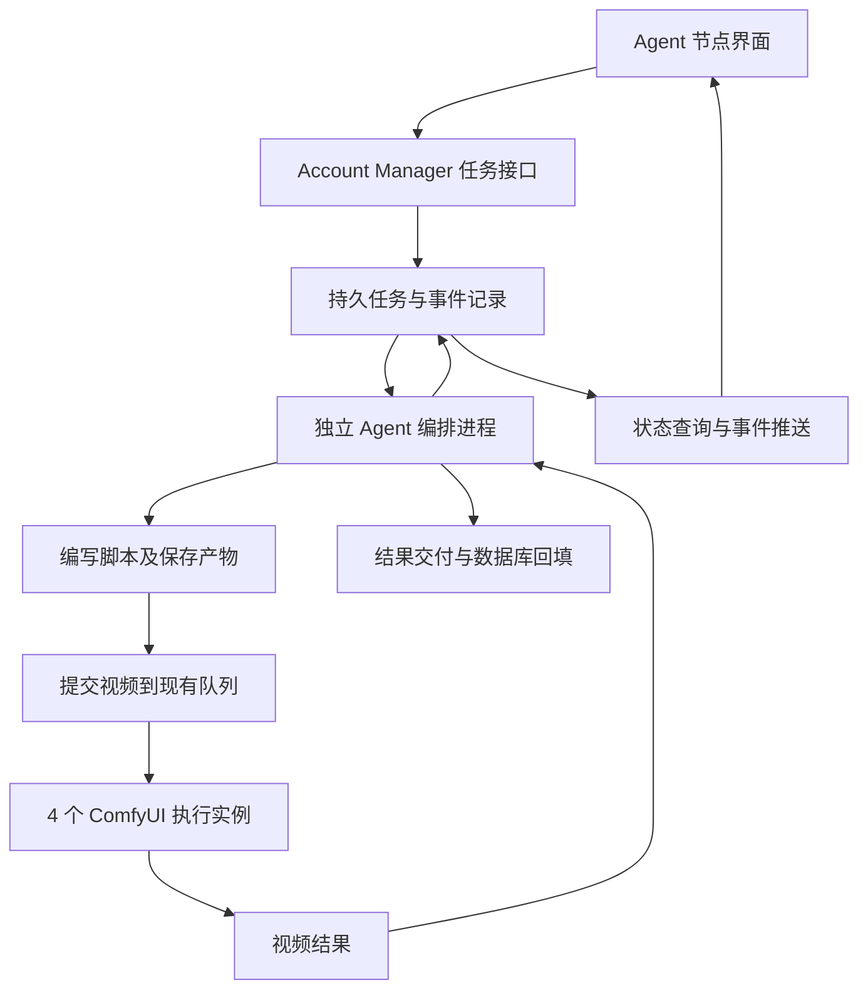

# 方案二：将 Agent 编排移出 ComfyUI 执行实例池

日期：2026-11-07  
状态：设计草案，供选型；尚未实施服务、节点或前端改造。  
对应方案：[方案一：父子任务容量预留](Agent并发方案一_父子任务容量预留.md)

## 1. 目标与结论

让编写脚本、调用工具、等待视频、结果回填这些 Agent 工作在独立编排服务中执行。ComfyUI 执行实例仅在实际执行视频或其他工作流时被占用。

在当前 4 个同类实例下，可以让多个 Agent 独立编写脚本，视频任务按队列最多使用 4 个实例执行。实际视频并发仍受账户、外部供应商及其他工作流占用限制，不承诺吞吐量必然翻倍。

前端仍可在 Agent 节点内展示进度、日志和结果，但任务不再依附于一条始终运行的 ComfyUI prompt。必须一起调整授权、任务状态、消息订阅、取消和结果交付。

## 2. 已确认的现状与关键区别

当前 `ComfyUI-LLM/agent_worker_client.py` 已经启动独立 Python 子进程，但会等待该进程返回；`nodes.py` 又等待这一结果。因此，“已有子进程”并不等于“已释放 ComfyUI 实例”。

当前 Account Manager 的 `utils/task_sessions.py` 通过运行中的父 prompt 确定 owner，并签发带 `am_task` 的凭据；父任务不再运行时，子任务授权会失效。这也必须随独立编排一起修改。

当前前端 `web/agent_node.js` 接收 `comfyui-llm-agent-progress` 事件并展示日志。可复用这些展示组件，但需要新的持久任务身份和事件恢复机制。

本方案不能用以下做法替代：

- 只把数据库状态改成 `waiting`，节点仍阻塞等待。
- 只启动后台进程，仍在原节点中轮询直到视频生成结束。
- 父 prompt 结束后继续沿用依赖该 prompt 为 `running` 的授权。

这些做法分别会保留实例占用，或导致后续授权失败。

## 3. 职责划分

| 部分 | 职责 |
|---|---|
| Account Manager 后端 | 持久任务身份、owner、编排队列与执行租约、权限、配额、状态、事件接口；视频继续进入现有调度器 |
| 独立编排进程 | 在 ComfyUI worker 生命周期之外运行 Agent，维护阶段检查点，提交视频和等待结果 |
| ComfyUI-LLM | Agent 技能、脚本生成、工具、产物规则、发布文案和回填逻辑；提供编排运行适配 |
| LLM Agent 节点与前端 | 提交任务、绑定任务 ID、展示消息与结果、发起取消；按需要实现输入和继续执行 |
| 现有 ComfyUI 实例 | 执行已提交的视频或其他 ComfyUI 工作流 |

Account Manager 管理通用任务生命周期，不应接管服装脚本、TikTok 文案等业务规则。独立编排服务可以仍部署在同一台 CPU 服务器，并复用已有 Agent Python 环境；不要求新机器，也不必第一版引入 Redis 或 Celery。

## 4. 建议架构与流程

完整时序：

1. 用户提交任务，服务端验证账户和输入，保存配置及规则快照，返回 `agent_task_id`。
2. 编排服务按独立的 Agent 并发限制领取任务，运行脚本与工具。
3. 需要视频时，持久保存请求及父子关联，向现有调度器提交子 prompt。
4. 视频池忙时，视频在队列等待，Agent 显示“等待视频容量”；不占一个 ComfyUI 实例原地等待。
5. 视频结束后，编排服务读取已绑定结果，继续交付和回填。
6. 持久记录最终产物、费用和结果状态，前端接收完成通知。

第一版可以让独立 Agent 子进程继续等待视频，先解决 ComfyUI 实例占用问题；这仍会占用一个 Agent 进程。进一步的可恢复阶段等待，需要把工具调用与恢复点显式持久化，不能假定现有 Agent SDK 可任意中断后原样恢复。

## 5. Agent 节点如何提交任务

两种入口可以分阶段支持：

| 入口 | 行为与限制 |
|---|---|
| 节点界面直接提交到编排 API | 完全不需要先取得 ComfyUI worker；适合输入已落盘或已存在的独立 Agent 业务流程 |
| 短执行的提交节点 | 普通工作流先准备输入，节点将输入保存为持久产物、创建任务后立即返回；短时间仍需 worker，但长时间编排与等待不占 |

建议先明确目标工作流：对于独立 TikTok 生产任务，可优先采用直接提交；存在上游图片处理节点时，使用短执行提交节点。不能在浏览器里直接获得尚未执行的上游 `IMAGE` 输出，也不能把仅存在于某个进程内存的张量引用交给后台服务。

重复点击或网络重试必须携带提交幂等标识。主动再次生成应创建新的任务，不能因 ComfyUI 节点缓存而错误复用旧任务。

## 6. 前端交互能保留到什么程度

可以保留 Agent 节点内的进度和日志展示，并扩展为与独立任务绑定：

| 功能 | 新机制 |
|---|---|
| 运行阶段、工具调用、执行日志 | 后台事件流按 `agent_task_id` 推送，前端继续渲染 |
| 视频排队及生成进度 | 展示该任务绑定的子 prompt 状态 |
| 完成后的图片、文本、视频 | 通过持久结果接口加载并展示 |
| 页面刷新、断线重连 | 读取任务快照，再从上次事件序号补齐事件 |
| 多个标签页或多个相同节点 | 用任务 ID 区分执行，节点 ID 仅用于定位画布显示位置 |
| 取消 | 向任务 API 提交取消请求，并显示后台确认状态 |
| 等待用户输入、确认及继续 | 若业务需要，新增持久交互请求和响应接口；不能仅依赖浏览器中的临时回调 |

这里的日志指现有可展示的运行摘要和工具事件，不意味着暴露模型内部推理。输入与确认能力需要核对现有功能后实施，不能认为切换执行架构就会自动具备完整双向交互。

ComfyUI 自带的“节点正在执行”标记，在短提交结束后会结束。节点应另行显示“Agent 排队 / 执行中 / 等待视频 / 等待输入 / 已完成”，区分“提交成功”和“业务完成”。

用户关掉网页不等于取消任务。重新打开后，可以从自己的任务历史重新绑定；删除节点也不应无提示地取消后台付费任务。

## 7. 最重要的兼容性边界：下游连线

当前 Agent 节点会等待最终结果并返回图片、文本、费用及视频。独立任务提交后立即返回时，最终视频尚不存在。

因此必须明确：前端能持续展示进度和最终视频，不代表 ComfyUI 原有下游连线可以自动异步获得结果。

建议采用显式的新提交模式或节点，保持旧同步节点的输出合同不被静默改变：

- 新提交节点输出任务 ID 和提交状态；最终结果通过节点界面或任务页展示。
- 不需要其他下游处理的 TikTok 流程，由编排服务完成视频归档和数据库回填。
- 有后处理需求时，在完成后提交独立的后处理工作流，并传入已存在的结果文件或结果 ID。
- 也可以提供读取已完成任务的结果节点；未完成时不能再次无限等待占用 worker。

自动拆分任意 ComfyUI 图并在任意节点断点恢复，不作为第一版目标。旧同步模式若继续允许生成子视频，仍需方案一的容量保护或限制准入，否则原死锁路径依然存在。

## 8. 持久状态与接口草案

以下名称用于说明设计，并非已有接口承诺。

任务建议状态：

`queued → running → waiting_video → running → delivering → completed`

额外状态包括 `waiting_input`、`cancel_requested`、`cancelled`、`failed` 和 `recovery_required`。视频子任务保留自己的排队、运行、成功或失败状态，不与 Agent 状态混用。

至少持久保存：

- 任务 ID、owner、创建时间、工作流和节点关联。
- 请求及规则版本快照、输入文件清单、任务输出目录。
- 当前阶段、执行租约、检查点和尝试次数。
- 子任务 ID、提交幂等标识、已知供应商任务 ID。
- 有序事件、最新状态版本、最终产物清单及交付状态。

建议任务接口包括创建、读取状态、读取增量事件、取消、读取结果，以及按需新增的交互响应接口。事件需要序号，允许重复传输并由前端去重；连接丢失时可以通过查询恢复，不依赖一次性的 WebSocket 消息。

SQLite 可以作为当前单机部署的首版持久层。事务应短小，网络请求和 Agent 执行不能放在数据库写锁内。若后续跨机器部署，再单独评估共享存储、消息服务和数据库方案。

## 9. 授权、配额和多用户隔离

独立任务必须有自己的服务端身份委托，不再要求某条父 ComfyUI prompt 始终处于 `running`。

- 任务 owner 来自已认证账户，不能从浏览器自报用户名中推断。
- 编排进程只取得该任务所需的受限凭据；凭据绑定任务、owner、权限和有效期。
- 提交视频、查询历史、读取输入输出都校验该任务及其子任务归属。
- 长任务支持受控续期；取消或终态后撤销新提交权限。
- 不把服务凭据写入日志、前端事件或提示词。

并发至少分开配置：

| 限额 | 作用 |
|---|---|
| Agent 运行并发 | 限制模型调用、工具执行、内存和进程数量 |
| 待处理 Agent 总量 | 防止无限提交导致队列及输出存储膨胀 |
| 视频执行并发 | 受健康 ComfyUI 实例数、账户和供应商限制 |
| 每账户业务任务及视频配额 | 保证账户之间的公平性和使用边界 |

Agent 等视频时可以继续占用独立进程额度作为首版简化；如果要让它不占“活跃推理”额度，必须另有限制等待任务数，不能无限创建挂起进程。

独立编排提交的视频在实例全忙时应正常入队，不能继续沿用“必须立刻有另一个空闲实例”的 409 检查。普通身份和配额校验仍保留。

## 10. 崩溃恢复、取消和付费任务幂等

独立服务增加了可恢复性要求，不能依赖父节点进程退出时自动清理一切。

| 故障或操作 | 处理原则 |
|---|---|
| 编排服务重启 | 通过租约识别待接管任务，从已保存阶段恢复 |
| 视频已经提交但提交响应丢失 | 通过幂等标识查找已存在任务；确认前不能重新付费生成 |
| 视频仍在运行 | 恢复状态查询，不再次提交 |
| 视频完成，数据库回填失败 | 单独重试交付，不重新生成脚本或视频 |
| 模型或工具在不确定步骤中断 | 进入恢复检查；只重试确定可安全重试的步骤，必要时由人工确认 |
| 取消排队视频 | 从队列撤销并记录状态 |
| 取消已执行的视频 | 请求停止，等待实际确认；供应商不支持取消时说明仍可能完成和计费 |

不能承诺所有外部操作天然“恰好一次”。若供应商没有幂等接口或可查询的请求标识，提交结果不明时应显示待核对，避免自动重复扣费。

第一版建议重点实现视频提交、视频等待、结果交付三个可靠恢复点。完整恢复任意 Agent 对话中间状态属于额外工程，不作为免费获得的能力。

## 11. 与现有文案和人工确认流程的关系

执行架构改变后，以下已确定规则仍然适用：

- `prompt.txt` 保存完整脚本；执行记录单独保存。
- 主体文案（英）读取第 7 节完整英文口播。
- 主体文案（中）读取第 8 节完整中文参考。
- 发布文案和标签按 `workflow/TikTok发布文案与标签规则.md` 生成，单独保存到 `post-copy.json`。
- 不调用 Gemini 反推口播，也不自动执行 Gemini 音画质检。
- 视频由人工确认；自动任务完成不等于人工审核通过，更不等于已经发布到 TikTok。

运行记录、规则快照、视频、数据库交付记录都应绑定同一 Agent 任务 ID。回填失败可沿用已有交付记录进行重试，避免修改已经确认的脚本文案。

## 12. 改动范围与部署

| 部分 | 需要的改动 |
|---|---|
| Account Manager | 独立任务存储、租约、身份委托、接口、事件、子任务关联、配额及取消 |
| LLM 后端 | 将节点调用与业务运行解耦，复用 `agent_worker.py`、`agent_runtime.py`，增加阶段恢复与产物交付适配 |
| LLM 节点 | 新提交语义、输入落盘、缓存和重复执行处理、旧输出兼容策略 |
| LLM 前端 | 独立任务绑定、进度与结果查询、重连补事件、状态和取消交互 |
| CPU 部署 | 新增独立编排服务的启动、守护、日志、健康检查和升级流程 |
| 视频工作流 | 原执行图尽量保持；提交身份和父子关联发生变化 |

不需要为了这一方案改造 ComfyUI 模型执行核心。新增生命周期和队列能力应放在 Account Manager 及 LLM 插件边界内。

## 13. 分阶段实施建议

1. **任务持久层与身份**：实现任务创建、owner、状态、租约、查询和取消，验证服务重启不丢任务。
2. **独立运行最小链路**：复用现有 Agent 子进程完成一条从脚本到视频及回填的流程；最初允许子进程等待视频。
3. **前端任务绑定**：节点提交后结束 ComfyUI 执行，继续显示独立任务进度、结果和刷新后的历史。
4. **结果合同**：明确采用新模式的工作流，验证后处理图、旧节点和输出类型的兼容边界。
5. **恢复与公平调度**：补齐付费提交幂等、取消竞态、交付重试和多账户并发。
6. **小范围切换**：先用一条独立业务流程验证，保留旧任务完成通道，再扩大使用范围。

若目标只是立刻消除容量失败，方案一先落地更小；若最终选择本方案，可以直接实现独立业务入口，不必先构建完整的预留系统。但迁移期间继续使用的旧同步视频 Agent 必须有容量保护。

## 14. 验收标准与回退

必须验证：

1. 多个 Agent 编写脚本或等待视频时，ComfyUI worker 不被父任务持续占用。
2. 4 个视频 worker 全忙时，新视频正常排队，Agent 不因缺少 idle worker 中途失败。
3. 刷新、断线、多标签页、重复节点 ID 不造成串任务、丢结果或越权展示。
4. 取消、服务重启、视频完成竞态不会重复生成或错误标记成功。
5. 父 prompt 结束后，独立任务仍能在授权范围内提交和查询自身子任务。
6. 新任务节点输出不会伪装成尚不存在的最终视频，旧同步工作流不会被静默破坏。
7. 第 7、8 节文案、独立发布文案及标签正确回填，交付重试不触发重新生成。
8. 页面明确区分提交完成、生成完成和人工确认。

回退应先停止独立任务新准入，保留服务处理或取消在途任务及交付，然后切换旧入口。数据库及产物保留用于追踪；不能关闭编排服务后任由外部付费任务失去管理。

## 15. 选型建议

| 需求 | 更合适的方案 |
|---|---|
| 尽快避免中途失败，节点下游连线保持原样 | 方案一 |
| Agent 经常长时间写脚本、等视频，希望释放实例 | 方案二 |
| 需要关网页继续执行、恢复任务及独立任务历史 | 方案二更适合，但需实际实现持久机制 |
| 当前没有精力改造授权、前端和结果输出 | 先采用方案一 |

本方案的主要收益是将编排并发与视频执行并发分离；主要成本是任务生命周期和节点输出语义的改造。选择前最需要确认的是：当前 Agent 的最终视频、图片或文本，是否还必须在同一次 ComfyUI 执行中传给下游节点。
